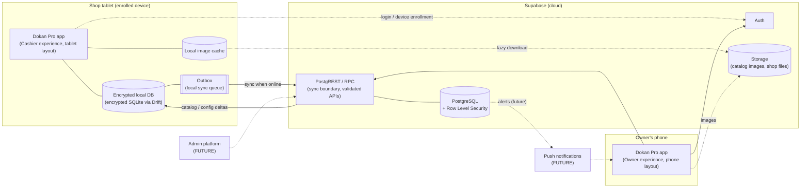
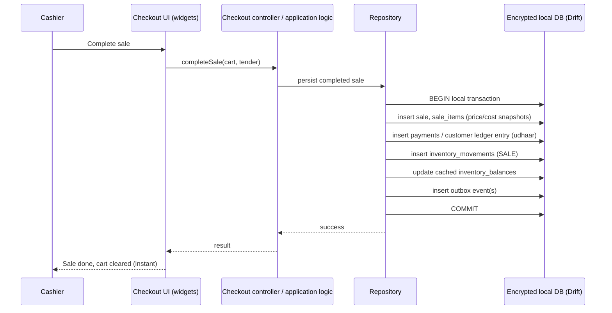
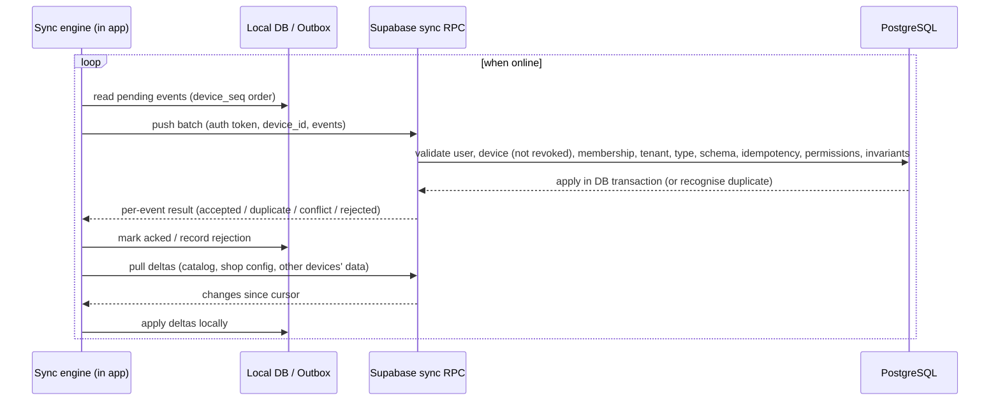
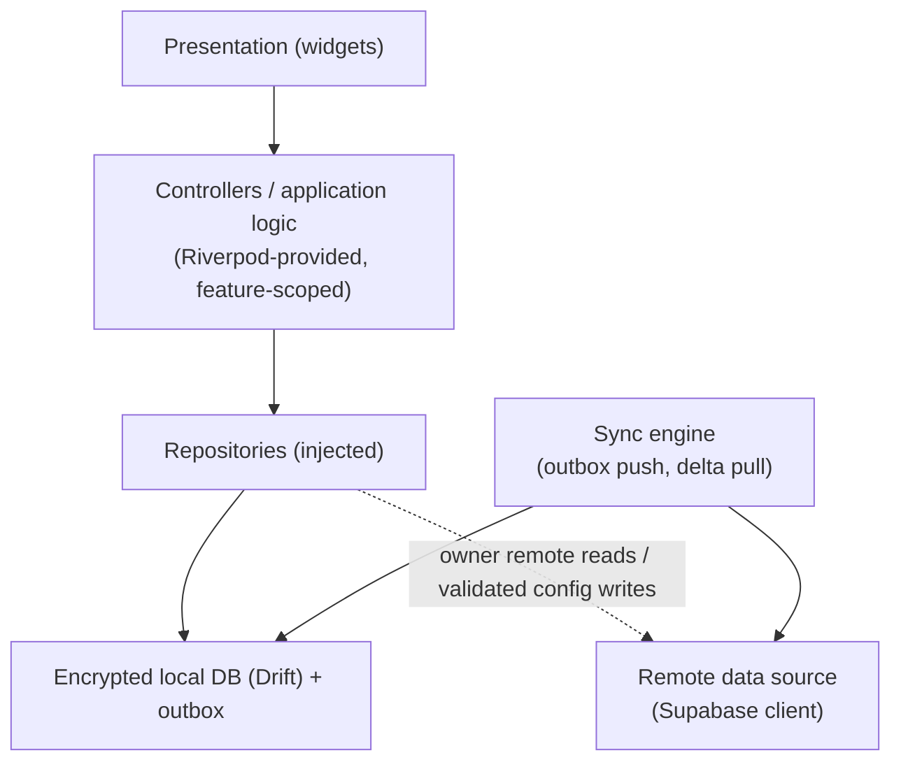

# ARCHITECTURE.md — High-Level Architecture

Status: **Conceptual (Phase 0).** No implementation exists. Names of components
below are conceptual boundaries, not final class/package names.

## 1. System overview

Dokan Pro is **one Flutter application** (one Play Store listing/package) that
serves OWNER, MANAGER, and CASHIER through **role-based experiences** and
**adaptive phone/tablet layouts** (ADR-026). The cloud backend is Supabase.



The two app boxes are the **same application** in different roles and form
factors, not two products.

## 2. The two paths (critical separation)

### 2.1 Local operational path — must work with zero connectivity



The local path **never** calls the network. Its success is determined only by
the local transaction committing. Every event records actor, device, local
session, shop, device occurred time, and `device_seq`; the server received time
is added at sync (ADR-021, ADR-023). The one deliberate checkout lock is a device
that has **learned** it is revoked (ADR-024) — this never depends on being online
at the moment of sale.

### 2.2 Cloud synchronization path — asynchronous, retryable



The sync path can fail, retry, and resume at any point without affecting
checkout. Details: `OFFLINE_SYNC.md`.

## 3. One application, role-based and adaptive experiences (ADR-026)

**Two separate concerns:**
- **Role controls capability** — what the authenticated user may see and do,
  derived from their shop membership (OWNER / MANAGER / CASHIER).
- **Device characteristics control presentation** — phone vs tablet layout.

Permissions are never inferred from screen size, and layout is never inferred
solely from role. One physical device is not permanently one role: a shop
tablet may mostly be used by cashiers, and an owner may use their own phone
(or the shop tablet).

```
Dokan Pro (one app)
 ├─ OWNER    → owner dashboard, sales/profit, inventory, udhaar, cashier activity, alerts, management
 ├─ MANAGER  → operational management, allowed reports, inventory operations, approved sensitive actions
 └─ CASHIER  → POS checkout, product search, shift, allowed customer/udhaar operations
```

**Role visibility in Flutter is not a security boundary.** Server-side
authorization, RLS, and the sync boundary (ADR-014) are authoritative; a modified
client must not gain owner capabilities by changing UI state.

### 3.1 Cashier experience (typically on an enrolled shop tablet)
- Tablet-optimized, checkout-first, large touch targets, minimal navigation.
- **Offline-first**: encrypted local DB, local catalog, local inventory, local
  outbox; local search (no per-keystroke cloud calls).
- No owner analytics in the cashier interface.
- Later: thermal printer and barcode scanner integration (Phase 15).

### 3.2 Owner experience (typically on the owner's phone; expanded layout on tablet)
- Mobile-optimized dashboard: sales, profit, inventory visibility, udhaar,
  cashier activity, alerts, management. Expanded adaptive layout on tablets —
  no second owner application.
- **Remote owner analytics require connectivity** for data that does not exist
  on that physical device; they are only as fresh as the shop's last sync, and
  freshness is always shown. Full offline remote analytics are **not** promised.
- If the owner uses an enrolled shop tablet, locally available information may be
  shown according to authorization.
- Configuration writes (prices, products, staff, permissions) go through validated
  cloud APIs with optimistic concurrency (ADR-022) and reach POS devices via sync.
  Whether owner config edits are offline-capable is open (Q10).
- The owner experience's needs must never make local checkout cloud-dependent or
  complicate the cashier checkout path.

### 3.3 Manager experience
- Operational subset of owner capabilities plus approved sensitive actions
  (e.g., void approval), on whichever device the manager uses.

## 4. Application structure (conceptual, ADR-026)

### 4.1 Repository layout (ADR-028: conventional Flutter root)
```
D:\POS_SYSTEM
├── android/          ← only platform (Android-first; no iOS/web/desktop)
├── lib/              ← the single Flutter application's code
├── test/             ← mirrors lib/
├── config/           ← dart-define example files only (no secrets)
├── .github/workflows/← CI: analyze + test
├── docs/
├── pubspec.yaml, l10n.yaml, analysis_options.yaml
├── AGENTS.md
└── README.md
```
Phase 1 chose the conventional Flutter root layout (no `app/` directory), as
ADR-026 permitted; the one-app architecture is unchanged. No monorepo tooling or
separate packages (e.g., `packages/core`, `packages/shared_ui`) are created for
artificial separation.

### 4.2 Feature-first organization (conceptual)
```
lib/
  app/        ← app shell, routing, role/layout selection
  core/       ← genuinely shared: money, quantity, identifiers, common errors,
                database infrastructure, security primitives, localization
                infrastructure, shared UI primitives
  features/
    auth/ shop/ catalog/ products/ inventory/ checkout/ shifts/
    customers/ udhaar/ purchases/ owner_dashboard/ alerts/ sync/
```
- Within a feature, add layers only when useful (e.g., `presentation/`,
  `application/`, `data/`); add a domain layer only where meaningful business rules
  justify it. No ceremonial empty Clean Architecture folders.
- `core/` is not a dumping ground: feature-specific behavior stays in its feature.

### 4.3 Layering and state management (Riverpod)



Rules:
- **Riverpod** is the primary state-management and dependency-wiring approach
  (package/version/code-generation strategy chosen at implementation; code
  generation is not mandated by Phase 0).
- Feature-scoped state preferred; **no giant global application state object**;
  **no mutable global business singletons**.
- **Widgets do not own database/network business logic.** Repositories and
  database dependencies are injected.
- UI state and persistent business state are different. **Riverpod memory state
  is never authoritative financial storage** — the encrypted local DB (then the
  cloud after acknowledgement) is.
- **Cashier financial operations never go to Supabase directly**: UI → controller →
  repository → encrypted local Drift transaction (record + outbox) → immediate
  result → cloud sync later.
- **The sync engine is the only component that moves operational data between the
  local DB and the cloud.** Owner remote reads (analytics, other devices' data)
  may use remote repositories directly.
- Money and quantity arithmetic lives in one shared, well-tested `core` module.

## 5. Local database

- SQLite via **Drift** (ADR-016) for transactions, shop product cache, master
  catalog cache, inventory ledger, sales, payments, local sessions, outbox, and
  sync metadata; installed in Phase 2.
- **Encrypted from the first implementation** (ADR-027): a SQLCipher-compatible
  encrypted SQLite implementation (or explicitly reviewed equivalent); exact
  package/adapter chosen in Phase 2. Strong random key protected by platform-backed
  secure storage (e.g., Android Keystore-backed); **never** hardcoded, committed,
  stored in plaintext preferences, or derived from a cashier PIN.
- Transactions are mandatory for multi-row financial writes.
- Local schema mirrors the conceptual model where needed but may differ from
  cloud schema (e.g., outbox table, sync cursors, image cache index are local-only).
- Local schema migrations must be versioned and tested (upgrade from every prior version).

## 6. Cloud backend (Supabase)

| Component   | Role |
|-------------|------|
| **Auth**    | Identity for owners, managers, cashiers. Tablets are enrolled to a shop online; cashiers then unlock offline with a local PIN (ADR-021; see SECURITY.md). |
| **PostgreSQL** | Durable, authoritative cloud copy of all shop data; global master catalog. |
| **RLS**     | Mandatory on every exposed table with shop data. Tenant isolation enforced in the database, not the client. |
| **RPC / functions** | The **server-side financial sync boundary** (ADR-014): idempotent, validated event ingestion — clients never insert financial rows directly. Also validated config updates with version checks (ADR-022) and delta pull. |
| **Storage** | Master catalog thumbnails (non-sensitive), shop-private files (e.g., custom product images) with shop-scoped access. |
| **Edge functions** | Only where SQL/RPC is insufficient (e.g., future push notifications). Not required initially. |

Cloud truth: the cloud database is the **durable, multi-device, authoritative
copy** once events are acknowledged. Each POS device is authoritative only for
events it created and has not yet synced.

## 7. Future components (not in current scope)

- **Push notifications** (Phase 13): alerts generated from cloud data, delivered
  to the owner experience via a push provider. The alerts table is the source;
  push is delivery only.
- **Admin platform** (future, post-MVP): catalog curation and promotion of custom
  products, shop management, subscriptions, support diagnostics. Uses separate
  admin roles; never shares service-role credentials with the Dokan Pro app.
- **Analytics read models** (Phase 16): aggregates derived from transactional
  data; never the financial source of truth.

## 8. Scaling posture

- Target: evolve toward **~5,000 shops**. Expected load per shop is small; the
  main scaling concerns are tenant-scoped indexing, sync batch efficiency,
  catalog delta distribution, and analytics aggregation.
- **Modular monolith first**: one Flutter app, one Supabase project, one PostgreSQL
  database, clear module boundaries (catalog, shop, sales, inventory, ledger, sync, audit).
- Every shop-scoped table is indexed with `shop_id` leading where queries are shop-scoped.
- No Kafka, Kubernetes, Redis clusters, or microservices without a demonstrated,
  measured need recorded in DECISIONS.md.
