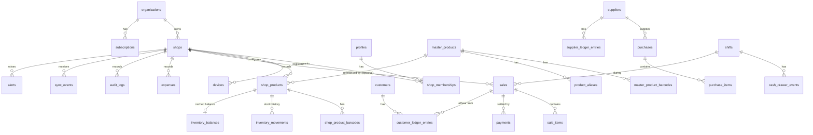

# DATA_MODEL.md — Conceptual Entity Model

Status: **Conceptual (Phase 0).** This is not a schema. No SQL types, columns,
or migrations are final. Names are working names.

## 0. Global conventions

- **Identifiers:** records created offline use client-generated random UUIDs
  (UUIDv4-style, ADR-013). **IDs are identity, not chronology** — never order by ID.
- **Ordering & time:** explicit fields only — `device_seq`, device occurred time,
  server received time, shop timezone, time-confidence/anomaly flags (ADR-023).
- **Tenant scope:** every shop-owned business record carries `shop_id`. The
  organization is reached through the shop. Global catalog data has no `shop_id`.
- **Money:** signed 64-bit integer paisa, never floating point; line amounts
  rounded half away from zero (ADR-008).
- **Quantity:** integer subunits, **1 unit = 1000** (e.g., 0.250 kg = 250); whole-piece
  products require multiples of 1000 (ADR-015). Fractional/loose goods are required (ADR-018).
- **Attribution:** financial/sensitive records carry actor user ID, `device_id`,
  local session ID, `shop_id`, device occurred time, server received time, and
  reason where applicable. Offline actor identity is **device-asserted** (ADR-021).
- **Immutability classes:**
  - **Append-only financial/audit** — never updated in business meaning, never
    hard-deleted; corrected by new records (VOID/REFUND/REVERSAL/ADJUSTMENT).
  - **Editable configuration** — may be updated; changes versioned and audited;
    "deleted" via deactivation (soft), never hard-delete if referenced.
  - **Derived/cache** — rebuildable from source records (e.g., balances).
- **Local-only structures** (outbox, sync cursors, image cache index) are
  described in OFFLINE_SYNC.md and are not cloud entities.

## 1. Relationship overview

## 2. Tenancy & identity

### organizations
- **Purpose:** the owning business entity (an owner's company/household); billing and top-level tenant.
- **Ownership / scope:** tenant root. Not shop-scoped.
- **Relationships:** has many shops, subscriptions.
- **Invariants:** at least one OWNER membership across its shops; a shop belongs to exactly one organization.

### shops
- **Purpose:** a physical store; the **primary tenant boundary** for business data.
- **Ownership / scope:** belongs to one organization. `shop_id` scopes all shop data.
- **Relationships:** memberships, devices, shop_products, sales, inventory, customers, suppliers, etc.
- **Invariants:** timezone (Asia/Karachi default) and currency (PKR) are fixed per shop; shops are deactivated, not deleted.

### profiles / users
- **Purpose:** a person's identity (linked 1:1 to a Supabase Auth user) — name, phone, preferred language.
- **Ownership / scope:** global identity; access to shop data only via memberships.
- **Relationships:** memberships; referenced as actor on financial/audit records.
- **Invariants:** a profile is never hard-deleted while referenced by financial or audit records (deactivate/anonymize policy — Q17).

### shop_memberships
- **Purpose:** grants a user a role (OWNER / MANAGER / CASHIER) in a shop, plus optional explicit permissions.
- **Ownership / scope:** shop-scoped.
- **Relationships:** profile ↔ shop.
- **Invariants:** unique (shop, user); a shop always has ≥1 active OWNER; role changes audited; revocation is a state change, not deletion.

### devices
- **Purpose:** a registered POS/owner device; source attribution for all events it creates.
- **Ownership / scope:** shop-scoped (POS devices belong to one shop).
- **Relationships:** events, sales, sync_events, audit_logs reference device.
- **Invariants:** enrolled to one shop while online; stable `device_id` per install; can be **revoked** — a device that learns of its revocation locks checkout, and sync from a revoked device is security-sensitive; its pending data is never silently discarded (ADR-024); per-device monotonic event sequence; per-device receipt/invoice number prefix.

### local_sessions (device-originated)
- **Purpose:** a cashier/manager session on an enrolled device, opened by online login or offline local PIN (ADR-021); every locally generated financial event references it.
- **Ownership / scope:** shop-scoped; created on the device, synced for attribution.
- **Relationships:** device, user, shift (relationship detail: Q9), financial events.
- **Invariants:** stores no PIN material; the device keeps only a salted PIN verifier in secure storage (the PIN itself is never stored, logged, or synced); records how the session was authenticated (online vs offline PIN).

## 3. Catalog (see PRODUCT_CATALOG.md — authoritative)

### master_products
- **Purpose:** global, reusable product identity (standardized name, brand, category, variant/size, unit type, default fractional-allowed indicator, image reference, active status, version metadata).
- **Ownership / scope:** **global**, admin-managed. No `shop_id`.
- **Relationships:** barcodes, aliases; referenced by shop_products.
- **Invariants:** **never** contains shop price, cost, stock/inventory, shop SKU, or shop thresholds. Deactivated, never hard-deleted once referenced. Each change bumps catalog version.

### master_product_barcodes
- **Purpose:** manufacturer barcodes (e.g., EAN-13) known for a master product.
- **Ownership / scope:** global.
- **Relationships:** master_product (many barcodes per product).
- **Invariants:** an active barcode maps to at most one active master product (conflicts resolved by admin).

### product_aliases
- **Purpose:** search aliases (English, Urdu, Roman Urdu spellings, common names).
- **Ownership / scope:** global for master products. Shop-level aliases for shop products — Q25.
- **Relationships:** master_product.
- **Invariants:** normalized for search; duplicates per product not allowed.

### shop_products
- **Purpose:** a shop's sellable product configuration: sale price, purchase price settings, enabled/disabled status, shop SKU, low-stock threshold, name override, selling unit and fractional-allowed flag. Either references a master product **or** is a custom product with its own identity fields.
- **Ownership / scope:** shop-scoped.
- **Relationships:** optional master_product; barcodes; movements; balance/cost state; sale_items; purchase_items.
- **Invariants:** editable configuration carries a **version** for optimistic concurrency — stale edits to important commercial fields produce a conflict, never silent last-write-wins (ADR-022); at most one active shop_product per (shop, master_product) unless variants are explicitly allowed (Q14); custom products are private to the shop and never auto-promoted; price changes don't alter historical sales; deactivated, not deleted. The authoritative moving average cost is **not** a freely editable field (see inventory_balances).

### shop_product_barcodes
- **Purpose:** shop-specific barcodes — custom/in-store barcodes and overrides of manufacturer barcodes.
- **Ownership / scope:** shop-scoped.
- **Relationships:** shop_product.
- **Invariants:** an active barcode maps to at most one active shop_product within a shop; shop barcodes take lookup precedence over master barcodes.

## 4. Inventory

### inventory_movements
- **Purpose:** **authoritative stock history.** Types: OPENING, PURCHASE, SALE, RETURN, REFUND, DAMAGE, ADJUSTMENT (and VOID reversal where applicable).
- **Ownership / scope:** shop-scoped; append-only.
- **Relationships:** shop_product; source document (sale_item, purchase_item, adjustment reason); user; device.
- **Invariants:** signed integer quantity in subunits (ADR-015); never updated or deleted; corrections are new movements; each SALE line produces exactly one movement; a VOID produces reversing movements; unit cost recorded where relevant (purchases, opening, sales at cost snapshot).

### inventory_balances (incl. average cost state)
- **Purpose:** **cached** current stock per shop_product for fast reads, plus the current **moving weighted average cost** (ADR-019).
- **Ownership / scope:** shop-scoped; derived.
- **Relationships:** shop_product; derived from inventory_movements.
- **Invariants:** quantity must equal the sum of movements; rebuildable at any time; **may be negative** (offline multi-counter sales, unrecorded purchases) — negative stock is a warning, not a blocker. Never treated as source of truth. Average cost is updated only by cost-affecting movements using integer-safe arithmetic; precision scale and edge cases (negative stock, returns, out-of-order events) are Q20/Q21.

## 5. Sales & payments

### sales
- **Purpose:** a completed checkout transaction (header): totals, discounts, status, shift, customer (if udhaar), device, cashier, receipt number.
- **Ownership / scope:** shop-scoped; append-only in financial meaning.
- **Relationships:** sale_items, payments, customer_ledger_entries, shift, device, user.
- **Invariants:** created only when completed (carts are not sales); totals = sum of items − discounts; the only status transition is COMPLETED → VOIDED, and it is driven by a separate, attributable VOID event with reversing movements/payments (the original rows are never rewritten); refunds link via separate records; never hard-deleted; receipt numbers unique per shop (device-prefixed for offline safety).

### sale_items
- **Purpose:** line items with **snapshots**: product name, selling unit, unit sale price, `cost_price_snapshot` (moving average cost at completion), quantity (subunits), discount, line amount.
- **Ownership / scope:** shop-scoped; immutable.
- **Relationships:** sale, shop_product, inventory movement.
- **Invariants:** line amount = unit price × quantity / 1000 rounded half away from zero (ADR-008); whole-piece quantities are multiples of 1000; snapshots never change after completion; historical COGS/profit uses `cost_price_snapshot`, never current cost (ADR-019).

### payments
- **Purpose:** tenders against a sale (CASH, DIGITAL — recorded JazzCash/Easypaisa/bank transfer, etc.) and refunds paid out; also receipts of udhaar repayments (payments table vs ledger only — Q26).
- **Ownership / scope:** shop-scoped; append-only.
- **Relationships:** sale (or customer for udhaar repayment), shift, user, device.
- **Invariants:** integer paisa; sale is fully covered by payments + udhaar amount; corrections via new linked records per ADR-020 (REVERSAL only for explicitly defined payment-correction scenarios — Q23).

> **Corrections (ADR-020):** a **cart cancel** creates no financial record. A
> **void** is full-sale only, manager/owner-permitted, reason-required, and
> creates reversing financial/inventory events linked to the untouched original.
> A **refund** (full, later partial) is a new linked financial record with its own
> items, payments out, and RETURN/REFUND movements; whether it is a typed `sales`
> row or a separate returns entity is Q4b (Phase 9). **REVERSAL** is reserved for
> explicitly defined system/payment corrections (Q23).

## 6. Udhaar (customer credit)

### customers
- **Purpose:** people who buy on udhaar (name, phone, optional credit limit).
- **Ownership / scope:** shop-scoped (organization-wide sharing — Q8).
- **Relationships:** ledger entries, sales.
- **Invariants:** deactivated, not deleted, while ledger has entries.

### customer_ledger_entries
- **Purpose:** append-only udhaar ledger: DEBIT (credit sale), CREDIT (repayment), ADJUSTMENT (with reason), and REVERSAL only for explicitly defined scenarios (Q23).
- **Ownership / scope:** shop-scoped; append-only.
- **Relationships:** customer, sale/payment source, user, device.
- **Invariants:** balance = sum of entries (any cached balance is derived); every entry has a source or a reason.

## 7. Purchasing

### suppliers
- **Purpose:** distributors/wholesalers the shop buys from.
- **Ownership / scope:** shop-scoped.
- **Invariants:** deactivated, not deleted, when referenced.

### purchases
- **Purpose:** stock received from a supplier (header): supplier, invoice ref, totals, paid/credit amount.
- **Ownership / scope:** shop-scoped; append-only in financial meaning.
- **Relationships:** purchase_items, supplier ledger, movements.
- **Invariants:** corrections via new linked correction records (ADJUSTMENT, or REVERSAL only where explicitly defined — Q23), never edits after posting.

### purchase_items
- **Purpose:** lines with quantity and unit cost.
- **Ownership / scope:** shop-scoped; immutable after posting.
- **Invariants:** each line produces one PURCHASE movement; unit cost updates the moving weighted average cost (ADR-019).

### supplier_ledger_entries
- **Purpose:** append-only payable ledger with suppliers (purchase on credit, payment to supplier, adjustments).
- **Ownership / scope:** shop-scoped; append-only.
- **Invariants:** balance derived from entries.

## 8. Cash & expenses

### expenses
- **Purpose:** shop operating expenses (rent, electricity, wages paid, etc.) for estimated net profit.
- **Ownership / scope:** shop-scoped; append-only (corrections via new linked correction records; REVERSAL only where explicitly defined — Q23).
- **Invariants:** integer paisa; category + reason; cash-drawer expenses also produce a cash_drawer_event.

### shifts
- **Purpose:** a cashier session on a device: open, close, opening float, counted closing cash, expected cash, difference.
- **Ownership / scope:** shop-scoped.
- **Relationships:** device, user, sales, payments, cash_drawer_events.
- **Invariants:** at most one open shift per device (multi-cashier per shift and relation to local sessions — Q9); closed shifts are immutable; differences recorded, never auto-adjusted silently.

### cash_drawer_events
- **Purpose:** non-sale cash movements: opening float, cash in, cash out/payout, expense paid from drawer, drop, closing count.
- **Ownership / scope:** shop-scoped; append-only.
- **Invariants:** reason required for cash in/out; attributable to user/device.

## 9. Audit, sync, alerts, subscriptions

### audit_logs
- **Purpose:** append-only record of sensitive actions (voids, refunds, price overrides, stock adjustments, role changes, device registration/revocation, login events).
- **Ownership / scope:** shop-scoped (platform-level admin audit separate, future).
- **Invariants:** never updated or deleted by clients; includes actor, shop, device, local + server timestamps, action, target, reason, before/after where applicable.

### sync_events
- **Purpose:** **server-side** receipt log of client mutations: event_id, shop_id, device_id, device_seq, idempotency key, schema version, timestamps, processing status/result.
- **Ownership / scope:** shop-scoped; append-only.
- **Invariants:** unique idempotency key per shop (duplicate submissions return the original result); (device_id, device_seq) unique; gaps in device_seq are detectable; original device occurred time preserved alongside server received time, with clock-anomaly flags (ADR-023).

### alerts
- **Purpose:** owner-facing notifications derived from data (low stock, large void/refund, cash difference, sync problems, clock skew).
- **Ownership / scope:** shop-scoped.
- **Invariants:** derived — never a source of financial truth; acknowledgment state editable.

### subscriptions
- **Purpose:** plan/billing status for an organization (future admin phase).
- **Ownership / scope:** organization-scoped.
- **Invariants:** subscription state must **never block a local cash sale** at the counter (grace/degradation policy — Q16).
